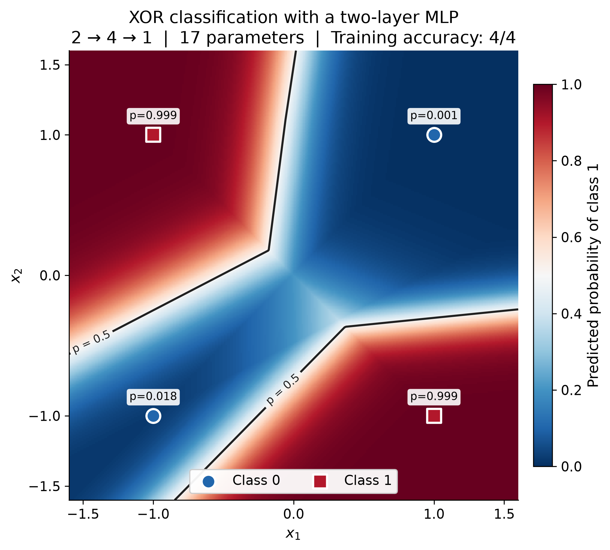

# Neural Networks from Scratch — A Path to Stanford CS336

Three completed PyTorch experiments: fitting a nonlinear decision boundary, selecting an image classifier on validation data, and generating text one character at a time. Each experiment began in a notebook and was consolidated into a standalone Python script.

I wrote the model, training, and evaluation workflows using PyTorch autograd and built-in layers. The experiments below document what I checked at each stage, from restoring a saved model to explaining why a language model cannot predict every target in its own training text.

## Stage A — Neural Network Foundations

Starting with linear regression and binary classification, I compared manual gradient updates with SGD, then trained a two-layer MLP on XOR. A single linear classifier cannot separate the four XOR points. Adding a ReLU between two linear layers lets the model learn a nonlinear decision boundary.

The `2 → 4 → 1` MLP has **17 trainable parameters**. After 3,000 SGD steps, it classified **all four training points correctly** with a binary cross-entropy loss of **0.005162**. Loading the saved weights into a fresh model reproduced the original outputs.



The background shows the predicted probability of class 1; the black contour marks the 0.5 decision boundary. The four points are the training set.

## Stage B — Fashion-MNIST Classification

I trained an MLP to classify 28 × 28 grayscale images into 10 clothing categories. The model flattens each image into 784 pixel values, applies `Linear(784, 128) → ReLU → Linear(128, 10)`, and returns one logit per class. It has **101,770 trainable parameters**.

I split the 60,000 training images into 54,000 training and 6,000 validation examples using seed 42. After five epochs of SGD on CPU (batch size 32, learning rate 0.1), the script reloaded the checkpoint with the highest validation accuracy into a fresh model and evaluated it on all 10,000 official test images.

| Standalone run | Result |
|---|---:|
| Selected epoch | 5 |
| Validation accuracy | 86.80% |
| Test accuracy | **86.41%** |
| Test cross-entropy loss | 0.373224 |

[Stage B learning notes (Chinese)](docs/stage_b_notes.md)

## Stage C — Character-Level Bigram Language Model

I trained a character-level language model on `"hello world"` using an **8 × 8 lookup table**. Each row corresponds to the current character; its eight logits score the possible next characters. Each SGD step sampled two windows with four next-character targets per window.

| Standalone run | Result |
|---|---:|
| Trainable parameters | 64 |
| SGD steps / learning rate | 1,000 / 0.1 |
| Full-text cross-entropy, before → after training | **2.0672 → 0.6473** |
| Correct next-character predictions on the original text | **7/10** |

The 7/10 result is the best a deterministic bigram predictor can achieve on this text. The character `l` is followed by `l`, `o`, and `d` in different positions, but the model must make the same prediction every time it sees `l`. That forces at least two errors. The two different successors of `o` force a third. Using the training text for this check makes the model's context limit directly observable.

Generation uses a different input: only the starting character is supplied, and each sampled character becomes the next input. Starting from `h`, one run produced `heldrlo wo wordeweldl` after 20 sampling steps.

[Stage C learning notes (Chinese)](docs/stage_c_notes.md)

## Run the Experiments

From the repository root, with the Python environment activated:

```bash
# Stage A: train the XOR model and plot its decision boundary
python scripts/stage_a_xor.py
python scripts/plot_stage_a_xor.py

# Stage B: train, select a checkpoint, and evaluate on the test set
python scripts/stage_b_fashion_mnist.py

# Stage C: train the bigram model and generate text
python scripts/stage_c_bigram.py
```

Stage A saves weights to `notebooks/stage_a/checkpoints/stage_a_final.pt`; the plotting script loads them without retraining. Stage B downloads or reuses Fashion-MNIST in `data/` and saves the selected weights to `checkpoints/stageb_fashion_mnist_best.pt`. Stage C uses an inline string and requires no dataset download. Metrics and generated text can vary across runs.

## Continuation

This repository is complete through Stage C. I’m continuing in [CS336 Assignment 1: Basics](https://github.com/YichenCharlie/cs336-assignment1-basics), my separate repository based on Stanford’s official starter code. The first task there is to train a byte-level BPE tokenizer: instead of assigning one ID to each character as in Stage C, the tokenizer learns which adjacent byte sequences to merge.