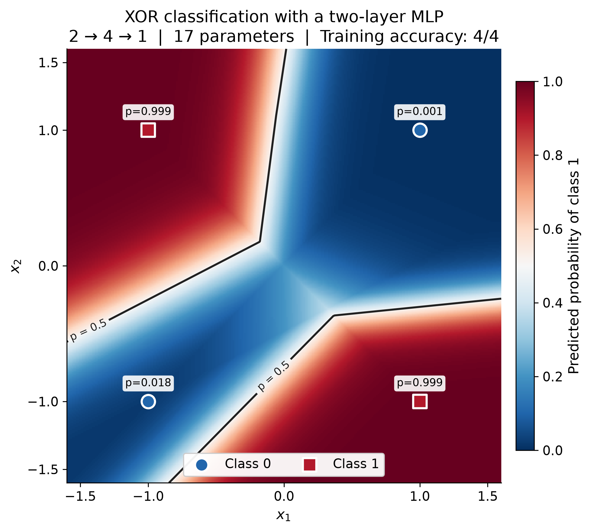

# Neural Networks from Scratch — A Path to Stanford CS336

Hands-on neural network implementation with PyTorch, progressing from small models to language modeling and ML systems.

This repository focuses on writing core code independently, understanding tensor operations and gradients, and checking model behavior through reproducible experiments. PyTorch autograd and built-in layers are used throughout the foundational exercises.

## Neural Network Foundations

Implemented linear regression, binary classification, and a two-layer MLP for XOR. Exercises cover manual parameter updates, SGD, activation functions, and model organization with `nn.Module`.

The final XOR exercise consolidates training, prediction, and weight saving/loading into a standalone Python script. Reloaded model outputs were verified against the original model.

| Component | Configuration |
|---|---|
| Architecture | Linear(2, 4) → ReLU → Linear(4, 1) |
| Trainable parameters | 17 |
| Loss | Binary cross-entropy with logits |
| Optimizer | SGD, learning rate 0.1 |
| Training steps | 3,000 |
| Final training loss | 0.005162 |
| Training accuracy | 4/4 |



The background shows the trained model's predicted probability of class 1; the black contour marks the 0.5 decision boundary. Markers indicate the four training samples. Results describe this training run, not generalization performance.

## Image Classification — In Progress

Started Fashion-MNIST exploration by loading the dataset, inspecting image tensors and labels, and visualizing samples.

The next step is to build a complete MLP classification workflow with mini-batch training, separate validation, and model checkpointing.

## Reproduce the XOR Experiment

From the repository root, with the Python environment activated:

```bash
python scripts/stage_a_xor.py
python scripts/plot_stage_a_xor.py
```

The training script saves weights to `notebooks/stage_a/checkpoints/stage_a_final.pt`. The plotting script loads those weights and saves the decision-boundary figure without retraining.

Results can vary with random initialization.

## Learning Approach

- Explore concepts and intermediate tensors in notebooks.
- Consolidate exercises into standalone Python programs.
- Verify tensor shapes, parameter counts, and save/load consistency.
- Prioritize implementation and understanding over benchmark scores.

## Direction

After completing image classification, build a small character-level language model, then progress to Stanford CS336 assignments on language modeling and systems.

## Tools

Python · PyTorch · torchvision · Jupyter · NumPy · Matplotlib

[Stanford CS336: Language Modeling from Scratch](https://cs336.stanford.edu/)